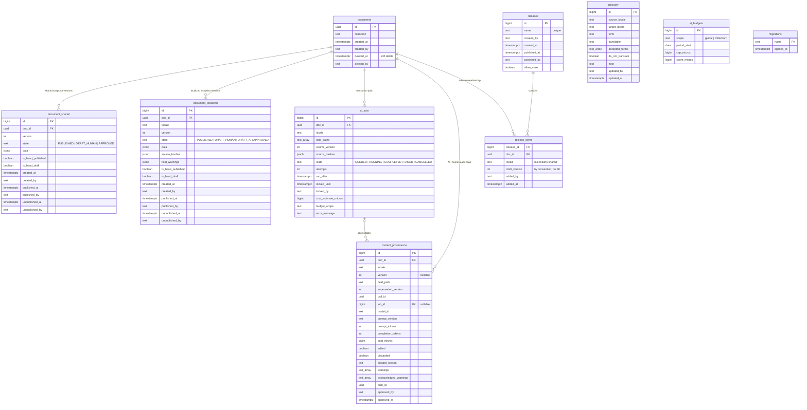
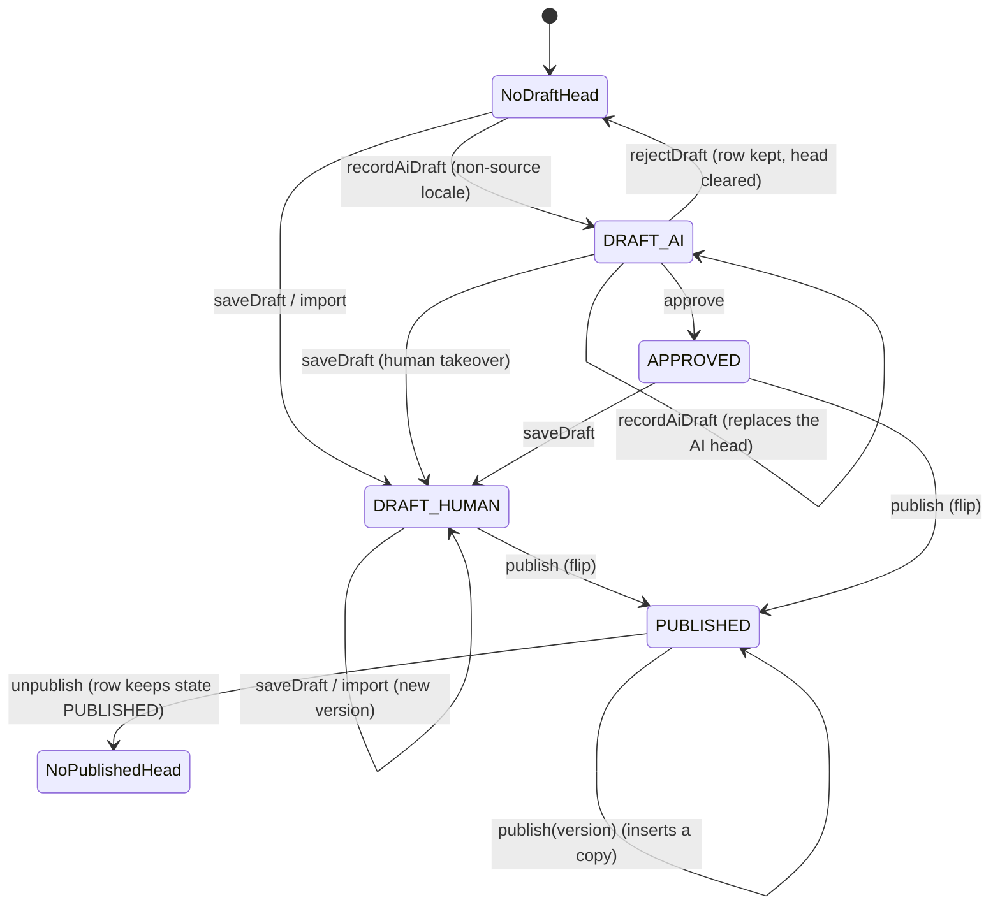

# Content architecture

This document describes how MoggingCMS models content, stores it, moves it through drafts and
publication, localizes it, and enforces access. It describes the engine as implemented in
`packages/core` (schema `0001_engine.sql`), not an intended future design.

MoggingCMS is a custom TypeScript engine, not Payload, Strapi, Sanity, Keystatic or Directus. The
usual CMS vocabulary maps onto it as follows:

| Usual CMS concept | In MoggingCMS |
| --- | --- |
| Collection / content type | A `defineCollection(name, fields)` value in the adopter's `mogging.config.ts`. There are no built-in collections. |
| Global / singleton | A collection whose fields are all **shared** (non-localized), or the shared fields of any document. There is no singleton enforcement. |
| Reusable block / component | No named block library. `object()` and `list()` compose structured fields; rich text keeps container directives as structured `container` nodes and MDX as opaque nodes. |
| Field component / custom widget | None. The engine has no admin UI and no field-component extension point. |
| Lifecycle hook (`beforeChange`, `afterRead`) | None. Each SDK operation has fixed behaviour. |
| Access-control function | None. The licence guard is the only gate; there is no user or role model. |
| Upload / media collection | None. Images in rich text are URLs supplied by the caller; the engine stores no binaries. |

## 1. Content models

### 1.1 Defining a collection

A content model is a TypeScript module. Collections are values, not database rows; the engine's
`documents.collection` column holds the collection name as text, and the config is the schema of
record at runtime.

```ts
import { defineCollection, defineConfig, slug, text, richText, number, boolean, dateTime, reference, list, object } from "@mogging/core";

const authors = defineCollection("authors", {
  slug: slug(),
  name: text({ localized: true }),
  bio: richText({ localized: true, body: true }),
});

const posts = defineCollection("posts", {
  slug: slug(),
  title: text({ localized: true }),
  excerpt: text({ localized: true, fallback: ["en"] }),
  body: richText({ localized: true, body: true }),
  published: boolean(),
  readingMinutes: number(),
  publishedAt: dateTime(),
  author: reference("authors"),
  tags: list(text(), { localized: true }),
  seo: object({
    title: text({ localized: true }),
    description: text({ localized: true }),
  }),
});

export const config = defineConfig({
  collections: [authors, posts],
  locales: { source: "en", chains: { de: ["en"], "de-CH": ["de", "en"] } },
});
```

`defineCollection` itself only wraps `{ name, fields }`. The validation happens in `defineConfig`:

- At least one collection is required.
- Collection names must be unique.
- Each collection must have **exactly one** field with `body: true`, and that field must be
  `richText`.
- A field with `kind: "slug"` cannot be localized. `slug()` takes no options, so every slug is
  shared.
- `source` and every chain key/target are BCP 47-normalized (`de-ch` → `de-CH`). Every chain target
  must be a declared locale (the source or a chain key).
- Locale chains are not forced to include the source locale. If `de` must fall back to `en`, declare
  `de: ["en"]`; the engine does not append the source implicitly.

### 1.2 Field kinds

| Builder | Accepted normalized value | Notes |
| --- | --- | --- |
| `text()` | string | NFC-normalized; empty string is a stored value. |
| `richText()` | string, object or array | Stored as the portable rich-text tree (or a legacy Markdown string); NFC-normalized recursively. Exactly one `richText` field per collection must set `body: true`. |
| `number()` | finite number | `NaN`/`Infinity` rejected. |
| `boolean()` | boolean | |
| `dateTime()` | `Date`, or ISO 8601 string with `Z`/offset | Stored as an ISO string in UTC (`toISOString()`, millisecond precision). A date without an offset is rejected. |
| `slug()` | string | NFC-normalized and lower-cased. Always shared; no options. |
| `reference(collection)` | document id string | The target collection name is metadata on the field; no foreign key or target-existence check is performed. |
| `list(item)` | array | Null elements are preserved as values. Items are normalized against `item`. |
| `object(fields)` | plain object | Undeclared keys are rejected; `undefined` values are dropped; `null` values are preserved. |

Every field builder accepts `FieldOptions`:

| Option | Default | Meaning |
| --- | --- | --- |
| `localized` | `false` | `true` stores the field in a per-locale snapshot; `false` stores it in the document's shared snapshot. |
| `fallback` | none | A per-field override: an ordered array of locale tags, or `"none"` to disable fallback. Only meaningful on localized fields. |
| `body` | `false` | Marks the collection's rich-text body. Exactly one per collection; `richText` only. |
| `required` | `false` | **Declared but not enforced in v0.1.** No read or write path consults this flag. Do not rely on it; see section 9. |

### 1.3 Relationships

The only relationship primitive is `reference(collection)`, and it stores **only the target
document id**. There is no foreign key, cascade, uniqueness check, or target-collection validation,
and `resolve` never expands references automatically. `resolveReference` and the Markdown importer
resolve them explicitly.

Lists and objects are embedded values, not joins. A list of references is `list(reference("x"))`,
but each entry is still just an id string. This is deliberate: the store is document-oriented and
snapshots are immutable, so cross-document integrity is an application concern.

There is also **no unique index on slug**. Two documents in the same collection can share a slug;
Markdown import identifies a document by `(collection, slug)` and can create duplicates if two
imports race (documented in `packages/markdown/README.md`).

## 2. Database model

The entire schema is in [`packages/core/migrations/0001_engine.sql`](../packages/core/migrations/0001_engine.sql).
`migrate` applies unapplied `*.sql` files in name order, each in its own transaction, and records
them in `migrations`.



Important properties:

- `documents.id` is a UUID. Every snapshot, job, provenance row and release item cascades from it
  except `content_provenance.job_id`, which is set to null when a job is deleted (jobs are not
  deleted by the engine in normal operation).
- **Heads are enforced by partial unique indexes.** For a shared snapshot, at most one row per
  document may have `is_head_published` and at most one may have `is_head_draft`. For a localized
  snapshot, the same holds per `(doc_id, locale)`. This is what makes concurrent writers safe.
- Versions are per scope, not global: `document_shared` is unique on `(doc_id, version)`;
  `document_localized` is unique on `(doc_id, locale, version)`. Two locales can both have version
  `3` with different content.
- `document_shared.state` cannot be `DRAFT_AI`; AI translation only produces localized drafts.
- `release_items.draft_version` and `content_provenance.version` refer to snapshot versions by
  convention, not by foreign key. There is no database guarantee that the referenced row still exists
  or is still the head; `publishRelease` re-checks this at publication time.
- `glossary`, `ai_budgets` and `migrations` are standalone. Glossary entries are per locale pair;
  budgets are per scope and UTC month.
- `migrations` is created by both the runner and `0001` (`if not exists`) so the first migration can
  run without a bootstrap special case.

## 3. Lifecycle and publishing

### 3.1 Snapshots, versions and heads

A document is created with `createDocument` and has **no content snapshot**. Every content write
creates an immutable snapshot row for one scope:

- the **shared** scope (`locale: "shared"` in the SDK), stored in `document_shared`; or
- one **locale** scope (`de`, `de-CH`, …), stored in `document_localized`.

A snapshot holds the complete set of fields for that scope, never a delta. `saveDraft` replaces the
scope's draft head with exactly the data passed in; fields omitted from `data` are absent from the
new snapshot. (`recordAiDraft` is the exception internally: it merges the translated fields into the
base snapshot before inserting.)

Each scope can have:

- at most one **published head** (`is_head_published`), and
- at most one **draft head** (`is_head_draft`).

The same row cannot be both heads: publishing a draft flips it to the published head and clears
`is_head_draft`. A new draft is a separate row with a higher version. A snapshot row's `state`
records how it was produced, not whether it is currently a head.

### 3.2 States and transitions

| State | Created by | Can be published directly? |
| --- | --- | --- |
| `DRAFT_HUMAN` | `saveDraft`, Markdown `import` | Yes, by anyone with database access. |
| `DRAFT_AI` | `recordAiDraft` (AI pipeline) | No. It must be approved first. |
| `APPROVED` | `approve` | Yes. |
| `PUBLISHED` | `publish` (draft flip or republish copy) | It is already published. A historical published row can be republished with an explicit version. |



Approval consumes a `DRAFT_AI` head; it does not mutate an `APPROVED` one. Approving an already
approved head is refused because the head is no longer `DRAFT_AI`.

### 3.3 Writing drafts

`saveDraft(ctx, { docId, locale, data, expectedVersion? })`:

1. Checks the licence (write guard) and the actor, validates the locale is declared (unless
   `"shared"`), loads the document and its collection.
2. Rejects undeclared fields, and rejects a localized field in the shared scope or a shared field in
   a locale scope.
3. Normalizes each value by field type, rejects U+0000, then removes top-level `null` keys. A
   top-level `null` therefore means "absent"; nested nulls are values.
4. Opens a transaction, locks the document row, compares `expectedVersion` with the current head
   (draft head, else published head, else `0`), and throws `ConflictError` on a mismatch.
5. Clears the existing draft head, allocates `max(version) + 1` for the scope, and inserts a
   `DRAFT_HUMAN` row with `is_head_draft = true`.
6. Computes `source_hashes`: the source locale hashes its own values. A target locale records the
   current published source hash for each **changed or new** field, and carries the base head's
   stored hash forward for unchanged fields. This is why a re-save does not silently assert that a
   translation is current; only `trackFields` does that.

A save over a `DRAFT_AI` or `APPROVED` head is allowed and replaces it with a human draft. That is
the "human takeover" path.

### 3.4 AI drafts and approval

`recordAiDraft` is the core-side write used by `@mogging/ai`:

- It only accepts a non-source, declared locale; AI drafts are translations.
- It cancels with `SOURCE_MOVED` if the source locale's published head is no longer the version the
  job was based on.
- It cancels with `DRAFT_HUMAN` if the current draft head is a human draft. It never overwrites
  human work.
- It merges the translated fields into the base snapshot (draft head, else published head, else the
  latest non-AI row), carries hashes and per-field warning texts, clears the old draft head, and
  inserts a `DRAFT_AI` head.
- It writes one `content_provenance` row per translated field.

`approve(ctx, { docId, locale, edits?, rejectFields?, acknowledgedWarnings?, bulkId?, expectedVersion? })`:

- Requires a `DRAFT_AI` head. It refuses `shared`, the source locale, undeclared locales, and
  non-localized fields.
- The acknowledgement gate is exact: every distinct warning text on the draft must appear in
  `acknowledgedWarnings`, and no unknown text may be acknowledged. `field_warnings` is a per-field
  map; the gate compares the set of distinct texts.
- `rejectFields` restores the currently published value for that field, or removes the field when
  there is no published value. Rejecting a field and editing it in the same call is an error.
- `edits` are normalized against the field type and assert "in sync with the source as of now" by
  writing the current source hash.
- It writes a new `APPROVED` draft-head version. The AI draft stays in history and is never
  publishable itself. Provenance rows for the AI version are copied to the approved version with
  token/cost columns zeroed; the copy keeps warnings, `superseded_version`, `call_id`, `job_id`,
  `model_id` and `prompt_version`, while `edited` / `discarded` / `discard_reason`, the acknowledged
  warnings and `bulk_id` describe the approval call. A `human:approve` marker row is added when an AI
  version has no provenance rows but carries warnings.
- `approveClean` scans every warning-free `DRAFT_AI` head in scope and approves each under one
  generated `bulkId`. A head that changed between scan and lock is skipped, not fatal. It does not
  approve warning-carrying drafts; there is no "approve everything" operation.

`rejectDraft(ctx, { docId, locale, reason?, expectedVersion? })` clears a `DRAFT_AI` draft head
without deleting the row, records a `human:reject` provenance row, and leaves the pair stale so a
later compile can regenerate it. It is not licence-guarded.

### 3.5 Publishing, unpublishing and time travel

`publish(ctx, { docId, locale, version? })` runs one transaction per call:

- Without `version`, it takes the current draft head and requires `DRAFT_HUMAN` or `APPROVED`; a
  `DRAFT_AI` head is refused with `NotPublishableError`.
- With `version`, it selects that exact row. The row may be the current draft head (a normal flip)
  or a historical `PUBLISHED` row that is not the current published head (a **republish**). Any
  other row is refused.
- It first clears the old published head (`is_head_published = false`, `unpublished_at`,
  `unpublished_by`) because the partial unique index permits only one.
- For a draft head, publishing **flips** the row: `state = PUBLISHED`, `is_head_published = true`,
  `is_head_draft = false`, `published_at`, `published_by`. No new row is created.
- For a republish, it inserts a **copy** as the next version with `state = PUBLISHED` and the same
  data/hashes, preserving the original row's own publication window for exact `asOf` reads. The
  draft head, if any, is untouched.
- One millisecond-granular timestamp is read from the database after the document lock and used for
  every stamp in the transaction, so JS `Date` precision and stored values agree.

`unpublish(ctx, { docId, locale })` clears the published head and stamps `unpublished_at` /
`unpublished_by`. It is a no-op when nothing is published, leaves the draft head untouched, and is
**not licence-guarded** (it only takes content offline). The row keeps `state = PUBLISHED`, so it can
be republished later with `publish(..., { version })`.

Time travel is read-only and applies to `resolve(..., { asOf })`:

- A snapshot is visible when `published_at <= asOf` and (`unpublished_at` is null or `> asOf`).
- A document is absent when `deleted_at <= asOf`.
- Publication windows are exclusive at the end: an unpublish at `T` makes the row invisible at `T`,
  and a publish at `T` makes it visible at `T`.

`deleteDocument` is a **soft delete**: it sets `deleted_at` / `deleted_by` and leaves every snapshot,
job, provenance and release item in place. There is no restore API in v0.1; restoring means writing
to the row outside the SDK. `resolve`, `listDocuments` (unless `includeDeleted`), the review queries
and the AI pipeline treat a deleted document as absent. `getDocument` is the exception: it returns a
deleted document by id, and by slug when no live document matches, with `deletedAt` set, which lets
an operator inspect history (see [API_INTEGRATION.md](API_INTEGRATION.md)).

### 3.6 Releases

A release is a named set of draft heads published together. It is a coordination tool, not a
scheduling tool.

- `createRelease` inserts a unique name and returns a decimal string id.
- `addToRelease` adds the **current** draft head of one `(doc, locale)` or shared scope. It requires
  `DRAFT_HUMAN` or `APPROVED`. An item already held at a different version is a `ConflictError`; the
  same version is an idempotent "already in release" case at the CLI layer.
- `removeFromRelease` works only on an unpublished release. It locks the release row only, so an
  item belonging to a soft-deleted document can still be removed.
- `publishRelease` locks the release, then all involved `documents` rows in ascending id order, and
  publishes every item in one transaction with one timestamp. It refuses an empty release and any
  item that is no longer a publishable draft head.
  - Before publishing, it re-checks staleness for each localized item against the source as it will
    be after the release: the in-release source draft if the release carries the source locale,
    otherwise the current published source head.
  - Stale items raise `StaleReleaseError` with an `items` array (`docId`, `locale`, `fields`).
    `allowStale: true` publishes anyway and records `releases.allow_stale = true`.
- A published release cannot be edited (`release already published`). There is no unpublish-release
  operation; unpublish individual heads instead.

### 3.7 Side effects

Publishing, saving and approving have **no external side effects**. The engine does not:

- call webhooks or HTTP endpoints,
- invalidate a CDN or a frontend cache,
- revalidate Next.js paths or tags,
- index a search engine,
- send email or notifications,
- run scheduled jobs or future-dated publication.

Every effect is a database row. A frontend must poll, re-fetch, or integrate its own revalidation
trigger around the SDK call. AI jobs have a `run_after` timestamp, but that is retry back-off, not
content scheduling.

## 4. Localization and fallback

### 4.1 Scopes

Every document has one shared snapshot scope and zero or more locale scopes. Fields with
`localized: false` live only in the shared snapshot; fields with `localized: true` live only in
locale snapshots. The body field and the slug are usually shared; whether a field is localized is
per field, not per collection.

The source locale (`config.locales.source`) is where humans author and the reference for staleness
and AI translation. It is a normal locale scope with one special rule: AI drafts cannot target it.

### 4.2 Resolution rule

`resolve(ctx, { collection, locale, ids?, limit?, asOf? })` applies the same rule per localized
field:

1. Build the field's chain:
   - `fallback: "none"` → `[locale]`;
   - `fallback: ["de", "en"]` → `[locale, "de", "en"]`;
   - otherwise → `[locale, ...config.locales.chains[locale]]` (or just `[locale]` when the locale has
     no chain).
2. Pick the first locale in the chain whose published head has the field present and not JSON null.
3. If no locale supplies it, the field is absent from `data` and listed in `missing`.
4. If the picked locale differs from the requested one, `fellBack[field]` names the locale that
   supplied it.

The SQL statement loads only the union of all chains, so resolution is one query regardless of
document count. `resolve` only sees **published** heads. It returns no draft content; there is no
`preview` flag.

Document visibility is narrower than field visibility:

- A collection with at least one localized field is returned only if the document has a published
  localized snapshot in some locale of the union of chains. A document with only a published shared
  snapshot is omitted, because there is nothing localized to render.
- A collection with no localized fields at all is returned on its shared published head alone.
- Deleted documents are omitted (respecting `asOf`).

`ids` filters to the given document ids. Non-UUID strings are ignored; an explicitly empty or
all-invalid id list returns `[]` without querying. `limit` must be a positive integer. Ordering is by
`created_at, id`.

### 4.3 Null, empty and suppression

This distinction is a storage contract:

- **Top-level null means absent.** `saveDraft` and `recordAiDraft` strip top-level null keys before
  writing. The field then falls back through its chain.
- **An empty value means present and intentionally empty.** An empty string for `text`/`slug`, an
  empty list, an empty object, or an empty rich-text tree is stored and selected before any
  fallback. It suppresses the fallback for that field.
- **Scalar numbers, booleans, date-times and references have no empty value.** A localized scalar
  that must not fall back declares `fallback: "none"` and resolves to absent when the locale lacks
  it.
- **Nested nulls are ordinary values.** The top-level field is the fallback unit; a `null` inside an
  object or list is preserved, not treated as absence.
- **`undefined` is not JSON.** `undefined` object properties are omitted during normalization; an
  `undefined` value where a field value is expected (including a top-level field) is rejected.

The read layer is driven by JSON null, not by emptiness: a stored empty string is still a value.
The "empty means suppress" rule is therefore the intended authoring contract for empty-able kinds,
not a special case in `resolve`.

### 4.4 Translation staleness

`getSyncState` measures every localized field of every declared non-source locale against the
source locale's **published head**. Documents without a published source head are not measured.

| State | Condition |
| --- | --- |
| `current` | The target has a stored source hash for the field and it equals the current source hash. |
| `stale` | The stored source hash differs. |
| `untracked` | The target has a value but no stored hash. |
| `missing` | The source has the field and the target has no value for it (including no target snapshot yet). |
| `orphaned` | The target has a value but the source no longer has the field. |

The target value used is the published head if present, else the draft head. A source change is
computed on read, not written to every target.

The hash is SHA-256 over the RFC 8785 canonical JSON encoding of the normalized value. Normalization
happens at write time, so `2026-11-11T08:00:00Z` and `2026-11-11T08:00:00.000Z` hash the same, and
NFC/NFD text hashes the same. Hash algorithm, normalization and canonicalization are part of the
storage contract; changing any of them forces a re-track or a re-translation.

`trackFields(ctx, { docId, locale, fields })` asserts "in sync with the source as of now". It writes
the current source hashes into the target's current head **in place** (published head preferred, else
draft head), creates no new version, and records one `human:track` provenance row per field. It
requires the source and target to both have values for each field.

## 5. AI translation pipeline

The pipeline lives in `packages/ai` and writes through `@mogging/core`. It is optional; the core
engine works without an AI config.

1. **Enqueue.** `enqueueStale(ctx, { locales, collection?, docIds? })` sweeps stale and missing
   fields and queues one job per `(document, locale)` with translatable fields. Translatable means
   localized `text`/`richText`, or a `list`/`object` whose leaves include text and no rich text.
   Numbers, dates, references and nested rich text are reported as `not translatable` and are never
   auto-copied. A `DRAFT_HUMAN` head is never overwritten; a pending `DRAFT_AI`/`APPROVED` draft that
   already covers the current source hash is skipped (`draft already current`).
2. **Jobs.** `ai_jobs` moves through `QUEUED` → `RUNNING` → `COMPLETED` / `FAILED` / `CANCELLED`.
   Workers claim with `FOR UPDATE SKIP LOCKED`, hold a lease (`locked_until`, `locked_by`), renew it
   while the provider call runs, and a reaper requeues expired leases with back-off or fails them at
   `maxAttempts`. A running job that loses its lease has its late result discarded.
3. **Budgets.** There is one global monthly cap and optional per-collection caps, enforced at claim
   time under the budget row lock. Estimates include a 1.5 safety factor. A cap of `0` pauses a
   scope. A separate per-run budget in `compile`/`runWorker` stops a run without changing job state.
   The cap is a quota on recorded spend, not a hard bound on the provider bill (see the AI known
   limits).
4. **Validation.** A draft is accepted only if:
   - the shape is right (list length and object keys preserved; non-text leaves unchanged; rich
     text restores into a valid tree);
   - placeholders `{name}` are the same multiset as the source;
   - do-not-translate glossary terms appear at least as often as in the source;
   - glossary translations or accepted forms appear where the source uses the term (`warn` records a
     warning; `strict` rejects);
   - no string contains U+0000.
   Rich text is sent as Markdown with code and opaque nodes replaced by sentinels; the originals are
   restored only if every sentinel appears exactly once at a legal position. A rejected draft is
   retried once with a stricter prompt; both calls are paid and recorded.
5. **Recording.** `recordAiDraft` inserts a `DRAFT_AI` head and per-field provenance. A human then
   calls `approve` (possibly with edits and field rejections) or `rejectDraft`. `approveClean`
   bulk-approves only warning-free heads.
6. **Provenance.** `content_provenance` records model, prompt version, tokens, cost in micro-dollars,
   warnings, acknowledgements, edits, rejections, `call_id`, and `job_id`. A call whose output was
   discarded still gets a row with `discarded = true` and a reason (`validation:`, `provider:`,
   `cancelled:`, `lease lost`, `commit_failed:`). Human marker rows use model ids such as
   `human:approve`, `human:reject`, `human:track`, `human:bulk-approve`.

The glossary is per locale pair (`source_locale`, `target_locale`) and unique on the term. It is
consulted for validation; it is not a translation memory and never supplies text automatically.

## 6. Access control and security

### 6.1 No authentication or authorization

v0.1 has **no users, roles, permissions, sessions, JWT, API keys, preview tokens or admin login**.
There is also no HTTP server to authenticate against. The security boundary is the database:

- Anyone with `DATABASE_URL` can call every SDK function and every CLI command.
- `--actor` / `MOGGING_ACTOR` is **attribution, not authentication**. The engine believes any string,
  records it on rows, and refuses only U+0000 (which Postgres cannot store). A caller can claim to be
  anyone.
- Approval records name the actor the process supplied; making that a real person is the
  deployment's responsibility.
- Run the SDK and CLI server-side. Never ship a database URL or database credentials to a browser.
  Frontends should read content through the application's own server, or through a read-only proxy
  the application builds.

Field-level and collection-level permissions do not exist. If an application needs them, it must
enforce them before calling the SDK; the SDK has no context for a user identity.

### 6.2 Licence guard

MoggingCMS is source-available, not open source. The licence guard is an offline write gate, not an
access-control system:

- The first 30 days after the **earliest row in `migrations`** are a free evaluation. An empty or
  missing `migrations` table counts as day one.
- `getLicenceState` returns `licensed`, `evaluation` (`daysLeft`, `warn` at ≤ 7 days) or `expired`
  (`daysLeft: 0`). A key is verified offline with Ed25519 against the public keys embedded in
  `packages/core/src/licence/publicKey.ts`.
- `MOGGING_LICENSE_KEY` wins over `config.license`. A supplied but invalid or expired key never
  licenses; `keyError` reports `LICENCE_INVALID` or `LICENCE_EXPIRED`.
- `assertLicensed` throws `LicenceError` `LICENCE_REQUIRED` after the window when no valid key is
  present. The message includes the purchase URL (`config.purchaseUrl`, default
  `https://mogging.dev/buy`) and the refusal text.
- Guarded writes: `saveDraft` (and therefore Markdown import), `enqueueStale` (and therefore
  `compile`), `runWorker`, `recordAiDraft`, `approve`, `approveClean`, `publish`, `publishRelease`.
  `createDocument` and `deleteDocument` are not guarded; neither are reads, `unpublish`,
  `rejectDraft`, `trackFields`, `release create/add/remove`, `cancelJobs`, or glossary and budget
  operations.
- Reads keep working after expiry, including `resolve`, `getDocument`, `listDocuments`, review
  reads, `listJobs`, provenance and licence state.

There is no online activation, seat counting, telemetry or network check. The private signing key is
offline and is read only by `tools/licence/sign.ts` from `MOGGING_LICENSE_PRIVATE_KEY`.

### 6.3 Input and data safety

- All SQL values and identifiers travel as bound parameters; the resolve query binds field names and
  locales as JSONB. No caller string is interpolated into SQL text.
- U+0000 is rejected before a query at every text boundary (actor, field values, object keys,
  release names, reject reasons) because Postgres cannot store it.
- Normalization rejects non-JSON values (`undefined` in arrays, non-finite numbers, class instances,
  `Date` outside `dateTime`) with `ValidationError` naming the field path.
- Money is stored as integer micro-dollars, never floating point.
- Deletion is soft; nothing is physically cascaded by the SDK, so a mistaken delete can be
  inspected in the database (`deleted_at` / `deleted_by`).
- No secrets are stored in the database by the engine. `config.license` holds a signed token, not a
  private key. Provider API keys are read from the environment and are never written to provenance
  or logs.

## 7. Media and assets

There is **no media or asset pipeline** in v0.1:

- No upload endpoint, multipart handling, file storage, S3/Cloudinary adapter, or local file store.
- No image transformations, resizing, format conversion, focal points, alt-text management, or
  responsive variants.
- No asset deletion or garbage collection.
- Rich text has an `image` inline node with `url`, `title`, `alt` and `marks`; it is a URL reference,
  nothing more. Markdown import reads the same node from `` and export writes it
  back.
- Markdown import/export moves text files only. It does not copy, upload, download, or verify the
  images those files reference.
- Opaque MDX nodes can embed a component that renders an asset, but the CMS neither manages nor
  validates that component.

An adopter that needs media hosts it elsewhere (object storage, a DAM, a static asset pipeline) and
stores URLs in content fields. The engine will round-trip those URLs but will not protect them from
breaking.

## 8. Markdown import and export

`@mogging/markdown` is the file-based authoring path. It is not a second content model; it maps onto
the same snapshots and lifecycle.

- **Layout:** `<dir>/<locale>/<collection>/<slug>.md` or `.mdx`. The relative path without the
  extension is the shared slug; the same relative path in another locale folder is the same document.
- **Front matter:** YAML keys map to field names. Undeclared keys are per-file errors. The Markdown
  body fills the collection's body field.
- **Shared fields:** read only from the source-locale file; shared keys in other locale files are
  ignored with a warning.
- **References:** a slug or UUID in the file. Import resolves slugs to document ids in two passes so
  forward references work. A `null` reference is an error.
- **Null vs empty:** a bare key (`banner:`) means absent; an explicit empty (`banner: ""`,
  `tags: []`) means suppressed.
- **Import behaviour:** each file is its own transaction; a file equal to the stored draft is
  `unchanged`; a re-import writes a new `DRAFT_HUMAN` (replacing an unpublished human draft) or
  replaces a pending `DRAFT_AI`/`APPROVED` draft with a warning when the file differs. A file equal
  to the published head leaves a pending draft untouched. `--publish` publishes drafts that equal the
  file in the same run.
- **Export behaviour:** writes **published** heads only, with shared fields in the source-locale
  file. It overwrites existing files without a check and never deletes stale files. Empties are
  written explicitly so a round trip stays `unchanged`.

## 9. Known architectural limits

These are properties of the current implementation, not bugs to discover:

- No HTTP/REST/GraphQL API, no admin UI, no auth/RBAC, no preview tokens.
- No lifecycle hooks, plugins, custom field components, or extension system.
- No scheduling, webhooks, cache invalidation, search indexing, or notification side effects.
- No media upload, storage adapter, or image transformation.
- No referential integrity for `reference` fields and no unique slug index.
- `required` is accepted by the field builders but never enforced.
- Migration `0001` was edited in place before v0.1; databases created before plan 4 must be
  recreated because the runner tracks applied migrations by name only.
- `content_provenance.version` and `release_items.draft_version` are conventional references without
  foreign keys; tooling must handle a missing or superseded target.
- `getDocument` can return a soft-deleted document (always by id, and by slug when no live match
  exists); `resolve` never does.
- The AI budget is a quota on recorded spend. Aborted or timed-out provider calls may be billed
  without recording spend, so the provider key's own spend limit is the real financial bound.
- The Starlight integration under `docs/superpowers/specs/2026-11-13-starlight-integration-design.md`
  is a design document. No Starlight package or starter template is implemented in this repository.
